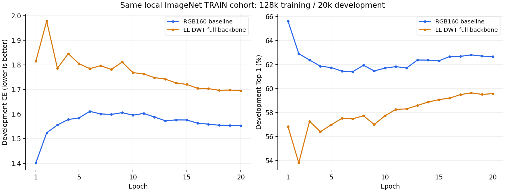
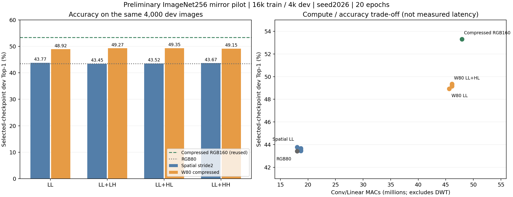
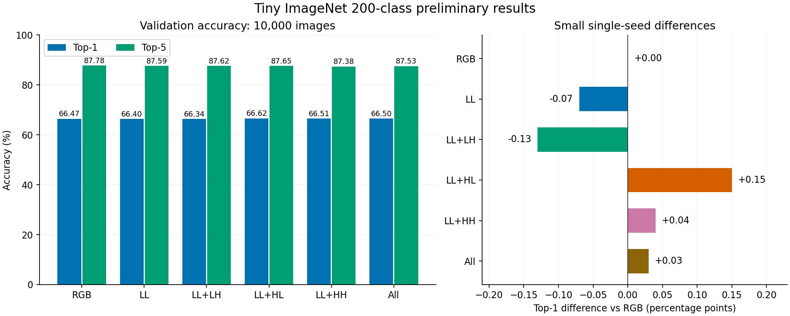
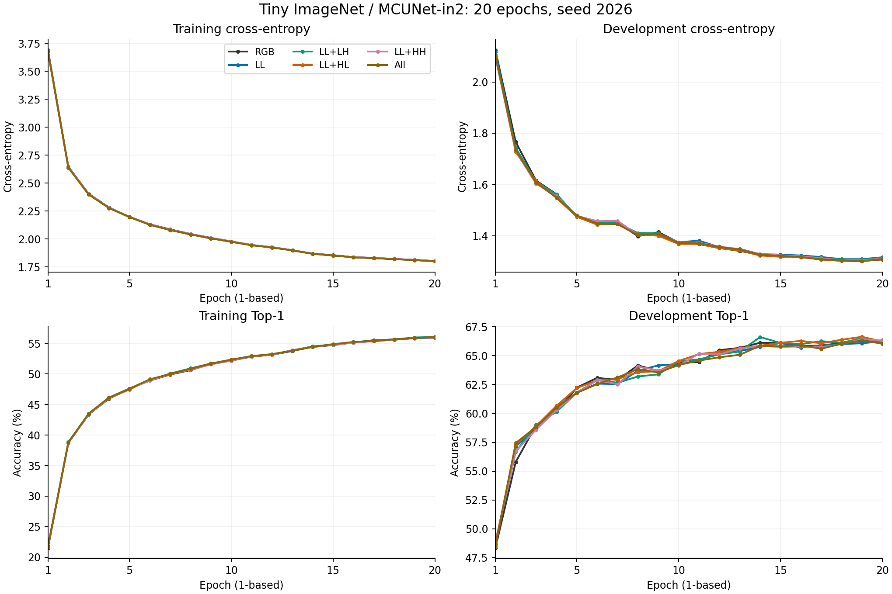

# MCUNet DWT ImageNet Baseline

## 2026-11-17 补零混合训练结果 原生80评估与224实验队列

以下为本次更新；下方旧日期段落保留当时状态。
160输入的RGB:LL=1:1、1:2、1:3均完成20轮。最佳LL补零Top-1分别为
47.340%、48.220%、47.960%；同权重原生LL80为37.080%、37.315%、37.275%。
补零160仍需67.2872M Conv/Linear MAC；原生80为18.021824M，减少73.22%，
但当前混合模型存在明显精度损失。不能将补零160成绩称为原生80成绩。

另归档已完成的RGB80对照、整批/批内混合、居中位置对比和TRAIN侧独立BN诊断。
这些均为固定128k/20k、1000类的本地内容开发实验，非官方val成绩或师兄精确复现。
224新队列已启动：RGB:LL=1:2、LL112居中补零224、batch64；随后RGB224对照，
再排batch32的同混合比例。224尚无最终准确率，不承诺达到参考文档中的81–85%。

[汇总结果、完整证据、计算量和224队列设置](results/wavelet_update_20261117/README.md)。


## 2026-11-13 小波方法更正 子集结果与后续计划

已核对参考方法为LL补零至原尺寸；此前插值放大和直接80输入均是独立实验，
新补零混合训练尚未启动。先做RGB-only、LL1-pad-only及混合训练的同预算对照，
再考虑LL2/3与实际加速；补零本身不会降低稠密CNN计算量。

LL1/2/3插值回160开发Top-1为61.100%/52.520%/40.200%，CNN均67.2872M MAC；
直接LL80原始/轻量增强为48.305%/48.570%，CNN18.021824M MAC，未证明增强整体改善。
全量RGB固定20轮官方50k val为60.230%/82.576%，与子集开发成绩分开报告。
当前RGB80对照为带日期的进度快照，不把未完成值当最终结果。

[实验计划、完整记录、方法更正与清理回执](results/wavelet_detail_20261113/README.md)。
旧模型/缓存按清单清理，当前训练及全量RGB最终权重保留。旧checkpoint引用可能仅为历史记录。
自己的仓库移除12个旧Tiny权重文件，SHA256和Git历史保留；不删除历史实验结果。


## Original ImageNet LL-DWT full run (2026-11-01)

The [completed 20-epoch LL-DWT report](results/dwt_uncompressed_ll_full20_20261101/README.md)
archives a full-backbone MCUNet-in2 experiment using original ImageNet TRAIN:
128,000 training / 20,000 development images, 1,000 classes, seed2026,
80,000 updates, FP32 and batch32. The new stem uses Haar LL at 80x80 after
the shared 160x160 RGB crop, followed by depthwise/pointwise convolutions.
Unlike the teammate's W80 groups, this experiment retains all backbone channels.

At the lowest full-development CE, LL-DWT reaches **59.585% Top-1 / 82.520% Top-5**
(epoch20, CE1.694531); the matching local RGB160 baseline reaches **65.630% / 86.605%**
(epoch1, CE1.401725). The Top-1 difference is **-6.045 percentage points**.
Per-image Conv/Linear MACs are **67.2872M (RGB) vs 65.0024M (DWT)**, only **3.40% lower**, while Top-1 is 6.045 pp lower. The [compute audit](results/dwt_uncompressed_ll_full20_20261101/compute_audit/README.md) reports per-layer counts, separate Haar arithmetic and candidate-structure costs. No latency gain is claimed.

These are development results; official ImageNet val/V2 have not been evaluated.
Both local runs share image contents and the frozen recipe, but their contents
do not match the teammate's sealed image manifest. This is not a claim of a DWT benefit
or a strict content-matched comparison with the teammate.

The report includes all 20 epochs, the RGB reference history/configuration,
learning curves, training/restore source snapshots, interruption/resource records,
SHA256 provenance and a standalone verification script. Checkpoints stay local.



## ImageNet256 preliminary validation (2026-10-29)

The [two-route pilot report and W80 protocol audit](results/imagenet256_pilot20k/README.md)
contains completed results, curves, logs, per-image development predictions,
sample lists, source snapshots and checkpoint hashes for 1,000 classes:
16,000 training / 4,000 development images, seed2026, 20 epochs per arm.
Nine queue jobs completed; one matching local compressed RGB160 control is reused.
These are preliminary results from a 256px center-cropped ImageNet mirror subset,
not full ImageNet-1K or official validation results. Data, update budget,
dependencies, RNG and operational differences from the teammate's original-image
128k/20k protocol are disclosed. Binary checkpoints remain local and are not
included in this publication. Tiny ImageNet results below remain separate.



## Completed Tiny ImageNet Experiment

All six groups completed 20 epochs on Tiny ImageNet (200 classes), using
95,000 training images, 5,000 held-out development images and the separate
10,000-image validation set. Best checkpoints were selected by development
cross-entropy. These are preliminary Tiny ImageNet results, not ImageNet-1K results.

| Input | Validation Top-1 (%) | Validation Top-5 (%) | Top-1 vs RGB (pp) |
|---|---:|---:|---:|
| RGB | 66.47 | **87.78** | 0.00 |
| LL | 66.40 | 87.59 | -0.07 |
| LL + LH | 66.34 | 87.62 | -0.13 |
| LL + HL | **66.62** | 87.65 | +0.15 |
| LL + HH | 66.51 | 87.38 | +0.04 |
| All subbands | 66.50 | 87.53 | +0.03 |





See the [full result report](results/tiny_imagenet/README.md) for per-epoch
logs, CSV results, model checkpoints, sample lists, per-image predictions
and reproduction commands. One seed was used; differences this small do not
establish a repeatable improvement.

## ImageNet-1K Baseline

This repository contains the ImageNet-1K fine-tuning baseline for comparing
raw RGB input with one-level orthonormal Haar subband inputs. The six groups
are `rgb`, `ll`, `ll_lh`, `ll_hl`, `ll_hh` and `all`.

The model is the ImageNet `mcunet-in2` checkpoint. RGB images are cropped to
160x160. Wavelet groups are transformed online after RGB augmentation and are
fed to the adapted first convolution at 80x80. The first convolution uses
stride 1 for wavelet groups so that its output and every later backbone feature
map keep the same spatial sizes as the 160x160 RGB model. Its first three input
channels are initialized from the RGB MCUNet stem; all added high-frequency
columns start at zero. All parameters and batch-normalization layers are
fine-tuned.

The subband order is `[LL/RGB, LH/RGB, HL/RGB, HH/RGB]`. Coefficient signs are
preserved. RGB input uses the official MCUNet normalization `(x-0.5)/0.5`.
For wavelet input, LL is mapped as `(LL/2-0.5)/0.5`; signed high-frequency
coefficients use `band/0.5`. These choices are recorded in every run's
`config.json`.

## Setup

For the small 200-class development dataset, see [TINY_IMAGENET.md](TINY_IMAGENET.md).
Its online-DWT pipeline test and full Tiny training commands are separate from
the ImageNet-1K benchmark below.

The repository is intentionally kept separate from the upstream MCUNet source.
From this directory, set:

```bash
export MCUNET_ROOT=../mcunet
python -m pip install -r requirements.txt
```

The matching configuration and checkpoint are already downloaded locally:

```text
weights/mcunet-256kb-1mb_imagenet.json
weights/mcunet-256kb-1mb_imagenet.pth
```

The original ImageNet files are not included. Point `--data-root` to an
ImageFolder-style directory containing `train/` or `val/` class folders.

On Windows PowerShell, download the matching files to an explicit directory:

```powershell
cd D:\MCUNet\MCUNet-DWT
python .\scripts\download_weights.py `
  --out-dir D:\MCUNet\MCUNet-DWT\weights
```

The upstream MCUNet source is expected at `D:\MCUNet\mcunet`. If it is stored
elsewhere, pass `--mcunet-root` explicitly to the training and evaluation
commands.

For a fresh Windows CUDA environment:

```powershell
conda create -n mcunet-dwt python=3.10 -y
conda activate mcunet-dwt
pip install torch torchvision --index-url https://download.pytorch.org/whl/cu121
pip install -r D:\MCUNet\MCUNet-DWT\requirements.txt
git clone https://github.com/mit-han-lab/mcunet.git D:\MCUNet\mcunet
```

## Smoke test

```bash
python scripts/smoke_test.py
```

This checks all six input shapes and confirms that every adapted model produces
1000 ImageNet logits.

## Train one group

The first run creates a deterministic stratified development split. Reuse the
same manifest for every group so the comparisons use identical samples:

```bash
python scripts/train_imagenet.py \
  --data-root /path/to/imagenet/train \
  --variant rgb \
  --run-dir runs/rgb \
  --split-manifest splits/imagenet_train_dev_seed2026.json \
  --epochs 20 --batch-size 256 --workers 8 --amp
```

Run the remaining groups by changing `--variant` and `--run-dir`:

```bash
for v in ll ll_lh ll_hl ll_hh all; do
  python scripts/train_imagenet.py \
    --data-root /path/to/imagenet/train \
    --variant "$v" \
    --run-dir "runs/$v" \
    --split-manifest splits/imagenet_train_dev_seed2026.json \
    --epochs 20 --batch-size 256 --workers 8 --amp
done
```

Each run writes `best.pt`, `last.pt`, `history.csv` and `config.json`.
`best.pt` is selected by the lowest development cross-entropy, and the official
validation set is never used for model selection.

The same training command in Windows PowerShell is:

```powershell
cd D:\MCUNet\MCUNet-DWT
$env:MCUNET_ROOT = "D:\MCUNet\mcunet"
python .\scripts\train_imagenet.py `
  --data-root D:\datasets\imagenet\train `
  --variant rgb `
  --run-dir D:\MCUNet\MCUNet-DWT\runs\rgb `
  --split-manifest D:\MCUNet\MCUNet-DWT\splits\imagenet_train_dev_seed2026.json `
  --config D:\MCUNet\MCUNet-DWT\weights\mcunet-256kb-1mb_imagenet.json `
  --weights D:\MCUNet\MCUNet-DWT\weights\mcunet-256kb-1mb_imagenet.pth `
  --mcunet-root D:\MCUNet\mcunet `
  --epochs 20 --batch-size 256 --workers 8 --amp
```

For the five wavelet groups, keep the same paths and change only `--variant`
and `--run-dir`. The validation directory should be
`D:\datasets\imagenet\val`.

## Evaluate the official validation set

```bash
python scripts/eval_imagenet.py \
  --data-root /path/to/imagenet/val \
  --variant ll \
  --checkpoint runs/ll/best.pt \
  --predictions runs/ll/val_predictions.csv \
  --batch-size 256 --workers 8
```

The evaluation writes Top-1/Top-5 accuracy and a per-image CSV containing the
relative image path, true class, predicted Top-1 class and predicted Top-5 IDs.

Windows PowerShell example:

```powershell
python .\scripts\eval_imagenet.py `
  --data-root D:\datasets\imagenet\val `
  --variant ll `
  --checkpoint D:\MCUNet\MCUNet-DWT\runs\ll\best.pt `
  --predictions D:\MCUNet\MCUNet-DWT\runs\ll\val_predictions.csv `
  --config D:\MCUNet\MCUNet-DWT\weights\mcunet-256kb-1mb_imagenet.json `
  --weights D:\MCUNet\MCUNet-DWT\weights\mcunet-256kb-1mb_imagenet.pth `
  --mcunet-root D:\MCUNet\mcunet `
  --batch-size 256 --workers 8
```

