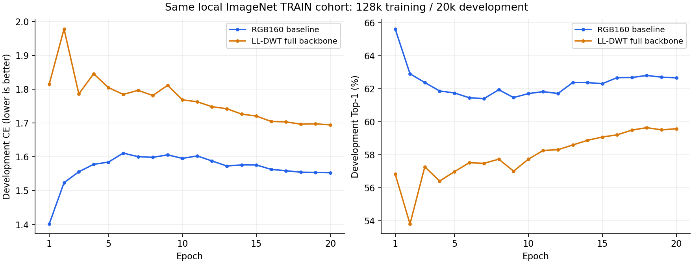

# 未压缩 LL-DWT：完整20轮结果与原图基线比较

2026-11-01。原始 ImageNet TRAIN 固定128k训练 / 20k开发，1000类，seed2026；20轮、80,000次更新完成。按完整开发集CE最低选择第20轮。

| 完整20k开发集 | 已对齐配方的原图RGB160 | 本次未压缩LL-DWT |
|---|---:|---:|
| 最佳轮次（CE最低） | 1 | 20 |
| CE ↓ | 1.4017248 | 1.6945309 |
| Top-1 | **65.630%** | 59.585% |
| Top-5 | **86.605%** | 82.520% |
| 第20轮Top-1 | 62.670% | 59.585% |

LL-DWT按各自最低CE选轮的Top-1低6.045个百分点；同为第20轮时低3.085个百分点。本次没有优于原图基线。DWT最高Top-1是第18轮59.650%，但选轮依据是CE，不能用它替换最终报告。



## 数据、160与协议的含义

RGB160是三通道原图在训练时生成160×160输入的简称，不是一个“160训练集”。两组读取同一原始ImageNet TRAIN嵌套tar，固定名单和本地图片字节/RGB内容一致。没有使用早期ImageNet256镜像或Tiny ImageNet。

共享协议为队友提交`432bc72840dbe01820e4eefbcda710a16fb73f0d`的冻结W80-E23协议。训练从原图随机选区域并缩放到160×160，scale=[0.08,1]、ratio=[0.75,4/3]、bicubic+antialias、flip0.5；开发集短边Resize182再CenterCrop160。见[交接原文](protocol/BASELINE_HANDOFF.md)与[冻结JSON](protocol/protocol_v1_frozen.json)。

共享batch32、FP32、关闭AMP/TF32、全参数及BN更新、CE、SGD momentum0.9/WD4e-5（含BN/bias），主干和头峰值LR0.001，新小波首层0.005。2轮warmup计入20轮cosine；相同早停条件与完整开发集CE选轮规则。配置逐字段核对见[comparison.json](comparison.json)。

两组本地manifest均为`0c68acdffbec6ec80835561962d94689eff4fdde5a3428858b5a117dd10653a7`，与队友封存`c3e2d54e9bcd5d5d1e03b96be5f45ad04fa384fad2d1cdf4878296e215f80179`不同。用户接受本地内容后开展实验。可以报告这两组本地比较，不能宣称与队友图片内容严格匹配；完整历史内容排除关系也未补齐。官方val/V2均未评估，这些数值不是最终测试准确率。

## 本次模型改动和结论边界

保留官方MCUNet-in2全部骨干通道和1000类分类头；RGB首层原3×3 stride2，DWT为Haar LL 160→80，加DW3×3 stride1/PW1×1→16，再接原BN/ReLU6。首层按每输入通道rank-1 SVD近似初始化（有损），训练用LR0.005。参数量RGB729,392，DWT729,035。

与队友四个W80组的区别是**未进行内部通道裁切**。LL单独使用在代数上等价于2×2平均池化加对应归一化。本次同时改变低通输入和首层结构/初始化，不能将差值全部归因于DWT，也没有证据表明高频子带组合或所有小波方案无效。单seed、开发集结果，不宣称统计显著性或部署性能。输入边长减半也不代表全网计算量减为四分之一。

## 产物与核验

- [20轮指标](history.csv)、[原图20轮指标](rgb_baseline/history.csv)、[完成记录](evidence/complete.json)、[配置](evidence/config.json)、[结果摘要](summary.json)。
- [训练日志](logs/attempt_001.stdout.log)、[事件](events.jsonl)、[资源日志](operations/resources.jsonl)。原始history/events/resources逐字节保存，含本机路径的JSON/文本仅做路径脱敏；原始和发布SHA分别记录在[SOURCE_RECEIPTS.json](SOURCE_RECEIPTS.json)。脱敏文件不能冒充原始文件哈希。
- [训练源码快照](code/scripts/)、[真实batch32 CUDA准入回执](evidence/cuda_admission.json)。准入验证了更新重放、BN/参数/优化器恢复、控制失败回滚、完整骨干/分类头保留。
- [检查点索引](checkpoints.json)记录best/latest字节数及SHA256；已验证本地文件。约6MB的训练checkpoint保留在本地，没有上传、下载链接或分片。
- 运行中发生过Windows重启与资源暂停，按checkpoint恢复，没有降低batch或精度。约01:38限制驻留文件缓存后至完成，647个资源采样没有再次暂停，最低可用内存4.730GiB。缓存限制及防空闲睡眠在训练结束后释放；AWCC/Dell及NVIDIA恢复策略仍是待恢复的主机设置。见[运行事件与处置](operations/INCIDENT.md)。

## 复现（本地Windows CUDA）

需要同一原始数据、固定队友/MCUNet checkout和官方预训练文件；本包不分发原图或权重。固定成员从队友checkout的`experiments/w80_e23/handoff`读取，不重新抽样。环境Python3.12.3、torch2.7.1+cu128、torchvision0.22.1+cu128、Pillow11.2.1、JPEG ABI6.2。先运行本报告目录的`python verify_snapshot.py`核验发布文件；不启动训练。

训练源码在`code/scripts`，不依赖本仓库旧版Tiny/镜像入口。例子中的绝对路径由使用者填写；输出设在本报告`reproduction`下以满足源码的独立输出目录约束。已有完成run不能直接续训，应保留原产物并选择新输出目录。

```powershell
$python = '<matching-environment-python.exe>'
$package = (Get-Location).Path  # current directory: this report
$team = '<checkout-at-432bc72840dbe01820e4eefbcda710a16fb73f0d>'
$upstream = '<clean-mcunet-checkout-at-9c164f8483003a5c6445871d94d30720aecc5918>'
$common = @(
  '--variant','dwt_uncompressed_ll',
  '--handoff-root',$team,
  '--train-tar','<original-ILSVRC2012_img_train.tar>',
  '--seal-dir',(Join-Path $package 'reproduction/seal'),
  '--weights','<mcunet-256kb-1mb_imagenet.pth>',
  '--mcunet-root',$upstream,
  '--accept-local-content-sha256','0c68acdffbec6ec80835561962d94689eff4fdde5a3428858b5a117dd10653a7'
)
# Separate-model admission; no formal training updates:
& $python -B code/scripts/check_w80_dwt_local_cuda.py @common --report-dir (Join-Path $package 'reproduction/admission')
if ($LASTEXITCODE -ne 0) { throw 'CUDA/content admission failed' }
# New full run; controller verifies source hashes and admission, workers0/prefetch1:
& $python -B code/scripts/run_w80_dwt_original_tar.py @common --run-dir (Join-Path $package 'reproduction/run') --admission-dir (Join-Path $package 'reproduction/admission')
```

`--accept-local-content-sha256`只接受上述已披露的本地封存，不能用于放行任意其他数据。主机缓存/电源辅助代码另存`code/host_recovery`作为操作记录，不是复现训练的科学参数，也不会随快照校验自动执行。更换机器和内容后需重新核验；不保证无人值守运行不会受系统故障影响。
