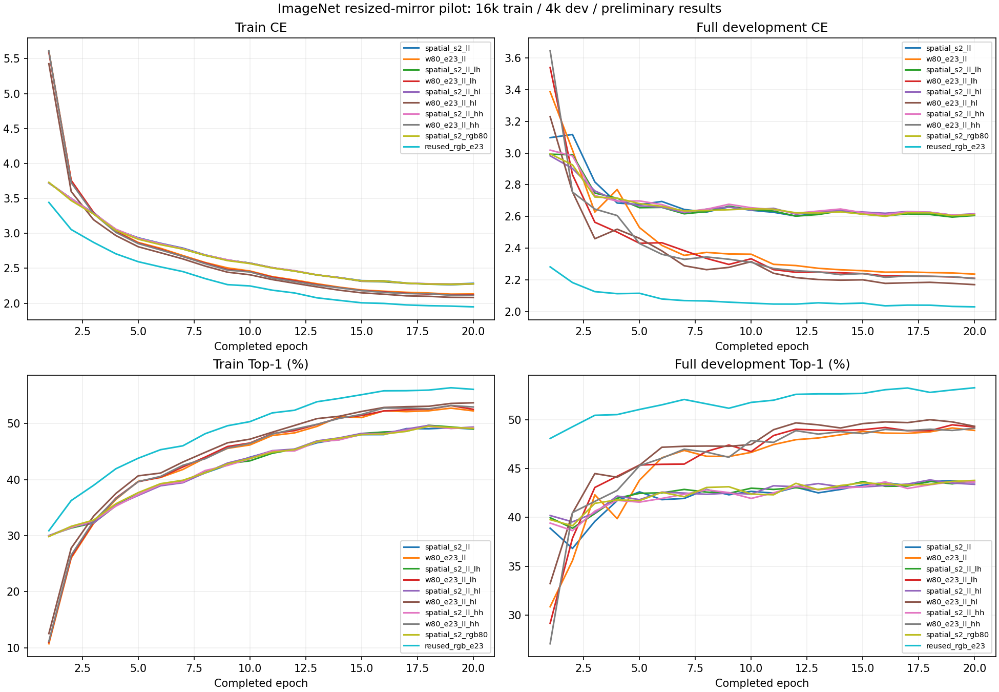
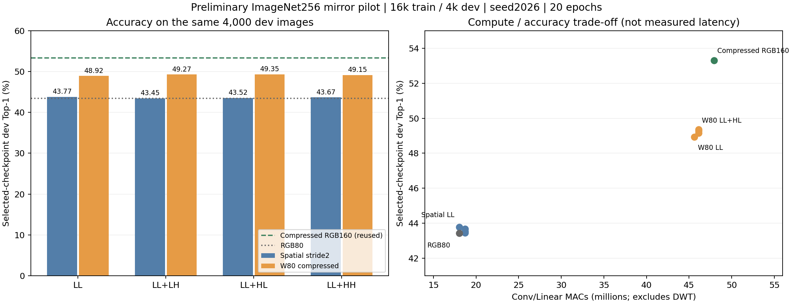

# ImageNet256 两路线初步验证（20k 子集，2026-10-29）

**这是已完成的小规模初步验证，不是完整 ImageNet-1K 结果，也不是队友原图 128k/20k 正式实验的匹配基线。**

来源：LUODN718/MCUNet-DWT 本地实验 `two_route_pilot20k`，北京时间 2026-10-29 10:36 完成。
9 个新队列任务全部完成 20 轮；另复用同一小规模划分上的 1 个已完成压缩 RGB160 对照。
每组 10,000 次已提交更新、320,000 次已提交训练图片曝光；seed=2026。
以下准确率均来自 4,000 张开发集，并以该开发集最低 CE 选轮；不应当作独立测试准确率。

## 结果

| 路线 | 输入 | Conv/Linear MACs | 所选轮次 | 开发 CE | 开发 Top-1 | 开发 Top-5 |
|---|---|---:|---:|---:|---:|---:|
| spatial_s2 | LL | 18.022M | 19 | 2.601423 | 43.775% | 68.675% |
| spatial_s2 | LL+LH | 18.713M | 19 | 2.596205 | 43.450% | 68.125% |
| spatial_s2 | LL+HL | 18.713M | 19 | 2.608842 | 43.525% | 68.675% |
| spatial_s2 | LL+HH | 18.713M | 19 | 2.608289 | 43.675% | 67.925% |
| w80_e23 | LL | 45.638M | 20 | 2.236065 | 48.925% | 74.275% |
| w80_e23 | LL+LH | 46.118M | 20 | 2.209269 | 49.275% | 74.675% |
| w80_e23 | LL+HL | 46.118M | 20 | 2.169647 | **49.350%** | **75.625%** |
| w80_e23 | LL+HH | 46.118M | 20 | 2.208526 | 49.150% | 75.475% |
| spatial_s2 对照 | RGB80 | 18.022M | 16 | 2.601056 | 43.425% | 68.225% |
| w80_e23 对照（复用） | RGB160 | 47.923M | 20 | **2.029481** | **53.300%** | **77.750%** |

MAC 只含全网 Conv/Linear，乘加记一次；不含 DWT、归一化、resize、GAP、残差等，不代表硬件时延或峰值内存。
最低 CE 选出的轮次不一定是 Top-1 最高轮次；例如 spatial_s2 LL+LH 第20轮 Top-1 更高，但 CE 更差，仍按冻结规则选择第19轮。





## 可以得出的初步结论

- W80 各小波组比同子带 spatial_s2 高 5.15–5.825 个 Top-1 百分点，但约使用 2.46–2.53 倍 Conv/Linear MAC；这是计算量和准确率取舍。
- W80 LL+HL 比仅 LL 高 0.425 个百分点；spatial_s2 加入高频均未超过仅 LL。只有一个 seed，不能确认这些小差异稳定有效。
- W80 最好小波组仍比压缩 RGB160 低 3.950 个百分点；双带只比压缩 RGB 少约 3.77% MAC。**小波相对压缩 RGB 的额外准确率收益未证实**，本轮未达到“精度损失不超过0.5个百分点”的目标。
- 第20轮各组 train/dev Top-1 差约 2.8–6.0 个百分点，但训练采用随机增强、开发采用中心裁剪，不能仅凭该差值判断过拟合。W80 各组最低 CE 仍在第20轮；spatial_s2 多在第19轮，不能据此断言已经充分收敛或存在严重过拟合。
- 没有原始 RGB160 的本轮未压缩准确率，不能从静态 67.287M MAC 推断它的准确率；Tiny ImageNet 历史结果另存，不能与本表直接横比。

## 数据到底用了多少

数据来源为 `benjamin-paine/imagenet-1k-256x256`，固定 revision `1bd0400450249a7fe90c0aece37d0d03e7ea956a`。
该镜像先对原图中心裁成正方形，再用 Lanczos 缩放到 256×256；256×256 指分辨率，不代表只有少量图片。
镜像完整 TRAIN 有 1,281,167 张。此前本机提取每类200张，共200,000张，另有50,000张镜像验证图。
本轮按“先用小数据集尝试”再次抽取每类16张训练、4张开发，即16,000/4,000；仍覆盖1000类。
这20,000张全部来自旧190,000张训练成员，旧10,000张开发成员未纳入。已排除镜像字节/RGB精确重复；完整项目历史原图身份排除未完成。
本轮开发图可能有预训练及历史训练曝光，不能称完全未见。官方 val、镜像 val 和 V2 均未用于本轮选轮或评估。

固定成员与校准身份见 [data/manifest.json](data/manifest.json)、[samples.csv](data/samples.csv)。固定1024张校准全部来自本轮训练集；校准在未压缩预训练 RGB 的 eval 模式下只做一次。
四个 W80 小波组和复用的压缩 RGB 共用 [channel_selection.json](data/channel_selection.json)，但它不是队友原图正式运行的生产索引。
类别0–999的 WNID 顺序见 [classes_canonical.json](data/classes_canonical.json)。

## 与队友最新训练方法的核对

核对分支 `experiment/w80-e23-imagenet-20261028`，固定提交 **`c8b4f13cbe64d19b7f404f61a6213aea541226f2`**。
[队友固定版本训练说明](https://github.com/LumiaBlack51/tinyml-progressive-inference/blob/c8b4f13cbe64d19b7f404f61a6213aea541226f2/experiments/w80_e23/TRAINING.md)。
对照其 `protocol_v1_frozen.json`、`TRAINING.md`、`execution.py`、`train.py`、`model.py`、`data.py`、`runtime.py`，而非只读旧 README 中尚待同步的历史段落。
机器可读记录：[alignment/audit.json](alignment/audit.json)。

| 项目 | 本轮与队友的关系 |
|---|---|
| W80 模型/Haar实现 | `model.py` 与队友最新提交字节完全一致；LL−1、2×HF，保留符号，LH垂直/HL水平方向一致 |
| stem与压缩 | DW3×3 stride1→PW16→BN/ReLU6；逐输入通道 rank-1 SVD 有损初始化，高频 PW列置零；18个MBConv保留0/1，其余扩展宽度约2/3，共享索引规则一致 |
| 预训练与头 | 相同官方 MCUNet-in2 权重 SHA256，保留1000类预训练头；全参数/BN参与训练 |
| 优化配方 | CE-only、SGD .9、WD4e-5；主干/头峰值LR .001，新小波stem .005；FP32/TF32关闭；micro/effective/BN batch32，无累积 |
| 增强算子 | RRC160 scale[.08,1]、ratio[.75,4/3]、bicubic+antialias、flip.5；dev/calibration Resize182+CenterCrop160。算子设置一致，但源图预处理与身份不同 |
| 调度与选轮 | 20轮含2轮warmup+18轮cosine；至少6轮、patience4+斜率/极差平台规则；最低完整dev CE取best，精确相同保留首次。相同规则按各自每轮步数缩放 |
| 数据/预算 | **不匹配**：256中心裁剪镜像16k/4k、500步/轮、10k总更新；队友原图128k/20k、4000步/轮、最多80k更新。不能按相同20轮称相同曝光预算 |
| 校准 | 相同算法和1024数量，但身份及实际indices不同，不能复用本轮RGB作为队友正式原图匹配对照 |
| 依赖/确定性 | **不匹配**：本地Python3.10.20/Torch2.5.1+cu121/torchvision0.20.1/Pillow12.2.0；队友冻结Python3.12.3/Torch2.7.1+cu128/torchvision0.22.1/Pillow11.2.1。队友另固定 deterministic_algorithms/CUBLAS配置，本地只固定cuDNN确定性 |
| 增强RNG实现 | **不匹配**：本地旧版worker0的`torch.manual_seed`会改CUDA RNG；最新队友改为仅设置CPU默认生成器。已实际核验该副作用，未修改或重算旧结果。当前源配置dropout_rate为0，但不据此声称执行轨迹等价 |
| 开发CE求和 | 本地每batch FP32 sum，队友逐图CE转FP64求和；同为完整CE选择，但不声称逐位一致 |
| 资源/故障记录 | **不匹配**：本地最终采用可选快照、无RAM水位暂停、有限自动重试；队友有watchdog/高低水位/物理尝试账本及真实agent复盘。两者恢复证据与耗时不可等同 |
| 额外空间路线 | 普通3×3 stride2使80px小波输入输出40×40，不压缩骨干；RGB80经bilinear+antialias缩小。这是本地额外对比，不属于队友W80正式组别 |

官方预训练 SHA256：`63565b5773a8aa70d75baf5a349f5f384da649804c48a5e7af1f655460158c7d`。
manifest SHA256：`927c40c229256733dfd91d42eea6d8ef82b2f64e8eeea9354c3363144e4483da`。
通道索引文件 SHA256：`f81b2dcd34f46063cbca2fc089abad23d79ffeb7d71923b3286585493771eed4`。
规范WNID映射 SHA256：`5e738e464c43c92037bbb4252eeb6ba2c306091861443ae7e182e28c9662324e`。

## 可复核材料与实际限制

- [results.csv](results.csv)：10组完整结果、所选轮次、MAC、实际已提交更新/曝光与耗时；官方验证列留空。
- [artifacts/](artifacts/)：每组20轮history、原始训练日志、summary/config、4000张开发逐图Top-5预测、best/last checkpoint哈希与大小。
- [code/](code/)：最终本地训练、Haar、模型、数据、检查及队列源码快照；来源`ce31c1d`的vendor保持原字节，并附SOURCE.json。不是覆盖队友最新正式实现。
- [evidence/](evidence/)：真实CUDA batch32检查、三次运维修复迁移回执、旧RGB复用协议；[source_history/](source_history/)存已找回的旧契约源码。
- 已逐组加载核验**20份本地best/last**的契约、优化器/RNG和进度；40,000行预测均复算出表中Top-1/Top-5；10组所选轮次均等于history最低完整dev CE。
- **二进制权重仍保存在本机，没有随本提交上传，也没有可下载checkpoint链接。** 因此这次发布尚不满足原任务单的完整在线模型交付要求；没有用哈希冒充可下载模型。
- 两个历史源码版本未找到原始字节：旧`train_route_pilot.py`（`e405780e…`）和旧`atomic_io.py`（`58a419a5…`）。哈希及缺失状态保留在source_contract_index.json，不能承诺所有早期运行逐位复现。
- 历史Windows快照权限/内存暂停曾中断训练，不能只因failed_attempts=0而声称从未中断。首次spatial_LL恢复至少重放50次物理更新/1600次曝光；精确总重放未知，表中是逻辑已提交量。最终无人值守队列没有触发新的自动重试，正常完成；计时口径含此前暂停，不能据此比较吞吐。
- 13项恢复/I/O回归测试（含真实子进程退出75后重启、实际Windows读取锁）和9组CUDA batch32检查通过；OOM为在真实BN更新后注入异常，不是耗尽设备显存的压力测试。
- 单seed、开发集选轮、无独立test、无INT8、无板端/时延/能耗结果；本目录不启动任何新训练。

## 核验与后续复现

在本目录运行：

```bash
python verify_publication.py
```

该命令使用标准库核对全部发布文件SHA256、20轮history最低CE选轮、同一4000张开发图和预测准确率；不加载Torch、不启动训练。
精确训练依赖与上游MCUNet提交见 [environment.json](environment.json)。历史代码原机器路径保留在config/queue回执中，迁移机器时不能直接照抄这些绝对路径。

若要重新做同一pilot：按固定revision取得同源JPEG并核对mirror字节/RGB哈希，放入`code/../datasets/imagenet-1k-256-subset200/train`；将`data/manifest.json`与`data/channel_selection.json`复制到`code/runs/w80_e23_pilot20k_v2/`的对应位置，使用源码提供的权重下载器和MCUNet上游。然后用`code/scripts/check_route_pilot_cuda.py`重新生成当前机器CUDA证据。单组入口为：

```bash
python code/scripts/train_route_pilot.py --run-root <new-queue-root>/<job> --shared-root <shared-root> --data-root <train-root> --mcunet-root <upstream-root> --route w80_e23 --variant ll --workers 0 --unattended
```

`<new-queue-root>/route_cuda_checks.json`必须存在且通过；新目录不含旧protocol/checkpoint。这只能重做pilot；当前归档源码保留已披露的旧RNG行为。
下一轮若采用队友最新CPU-only RNG、依赖环境、原图128k/20k或更大数据，必须建立新清单/源码锁/校准/运行目录，从相同预训练初始化重新比较，并保留本轮结果为历史初步验证。不能重命名本轮结果当作正式对齐结果。
