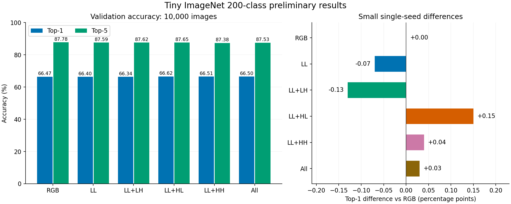
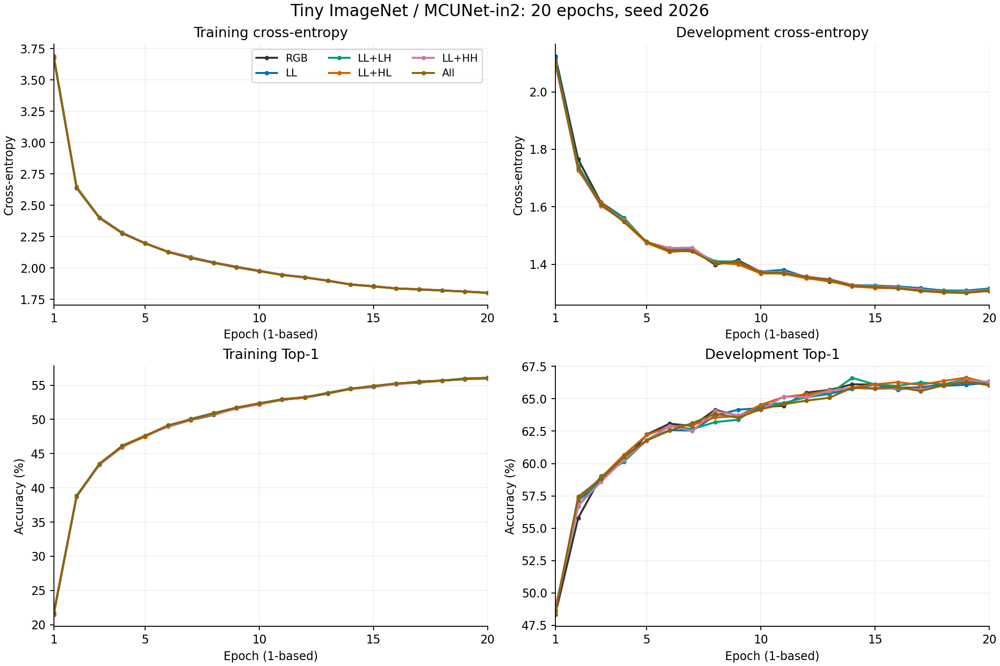

# Tiny ImageNet Six-Group Results

All six groups completed 20 epochs on the shared 95,000/5,000 train/dev split.
Each selected checkpoint was evaluated on the same 10,000 validation images.
These are preliminary 200-class results, not ImageNet-1K benchmark results.

Protocol: seed 2026; batch 32; SGD momentum 0.9; LR 0.001; cosine decay;
weight decay 0.00004; CUDA AMP. RGB augmentation precedes online orthonormal Haar DWT.
The new 200-class head and LL stem weights were identical at initialization.

| Group | Selected epoch (1-based) | Dev CE | Dev Top-1 (%) | Val Top-1 (%) | Val Top-5 (%) | Top-1 delta (pp) |
|---|---:|---:|---:|---:|---:|---:|
| rgb | 19 | 1.302093 | 66.26 | 66.47 | 87.78 | +0.00 |
| ll | 19 | 1.308684 | 66.08 | 66.40 | 87.59 | -0.07 |
| ll_lh | 19 | 1.305169 | 66.52 | 66.34 | 87.62 | -0.13 |
| ll_hl | 19 | 1.300191 | 66.64 | 66.62 | 87.65 | +0.15 |
| ll_hh | 19 | 1.304088 | 66.44 | 66.51 | 87.38 | +0.04 |
| all | 19 | 1.301012 | 66.32 | 66.50 | 87.53 | +0.03 |

LL+HL has the highest observed validation Top-1 (66.62%), 0.15 percentage points above RGB.
LL alone is 0.07 percentage points below RGB. RGB has the highest Top-5 (87.78%).
The small differences in this single-seed run do not establish a repeatable improvement.
All groups selected epoch 19 by minimum development CE. CE rises slightly at epoch 20;
the saved best checkpoints avoid selecting that last-epoch regression.

Checks passed: equal protocol/initialization/class mapping/split; complete epoch counts;
minimum-CE checkpoint selection; resumable checkpoint state; 10,000 unique predictions per group;
Top-1/Top-5 independently recomputed from prediction CSVs.

Per-group directories contain config.json, class_mapping.json, train.log, history.csv,
curves.png, best.pt, last.pt, val_predictions.csv and val_predictions.metrics.json.
The shared sample manifest is recorded by config.json. ImageNet-1K validation columns are blank.

## Visualizations





Training uses random crops and flips while development uses deterministic
center crops. Their accuracy/loss gap alone is not evidence of overfitting.
Development CE plateaus late and rises slightly in the final epoch; longer
training and repeated seeds have not been evaluated.

## Files

- `results.csv`: six-group summary; selected epochs are 1-based here.
- `<variant>/history.csv`, `train.log`, `curves.png`: all 20 epochs.
- `<variant>/best.pt`, `last.pt`: portable copies including resume state.
- `<variant>/val_predictions.csv`: all 10,000 image IDs, labels and Top-5 IDs/names.
- `<variant>/config.json`, `class_mapping.json`: settings and common 200-class mapping.
- `splits/`: exact shared split and all 100,000 training-pool image IDs.
- `environment.json`: recorded training versions and export environment versions.
- `SHA256SUMS.txt`: checksums for all exported artifacts except this checksum file.

The checkpoint/history epoch fields are 0-based (18 means the 19th epoch).
Published metadata paths are repository-relative; original local runs are
unchanged. No original images or source pretrained weights are included.

## Reproduce

Install a matching CUDA-enabled PyTorch/torchvision pair and requirements.txt.
Clone the upstream MCUNet repository beside this repository, place Tiny ImageNet
under `../datasets/tiny-imagenet-200`, and fetch the official pretrained weights.
Run from the repository root in PowerShell:

```powershell
python scripts/download_weights.py --out-dir weights
$groups = @('rgb', 'll', 'll_lh', 'll_hl', 'll_hh', 'all')
foreach ($g in $groups) {
    python scripts/train_imagenet.py --dataset tiny-imagenet --data-root ../datasets/tiny-imagenet-200/train --variant $g --run-dir runs/reproduce_tiny/$g --split-manifest results/tiny_imagenet/splits/tiny_train_dev_seed2026.json --mcunet-root ../mcunet --epochs 20 --batch-size 32 --workers 2 --seed 2026 --lr 0.001 --weight-decay 0.00004 --dev-fraction 0.05 --device cuda --amp
    if ($LASTEXITCODE -ne 0) { throw "Training failed: $g" }
}
foreach ($g in $groups) {
    python scripts/eval_imagenet.py --dataset tiny-imagenet --data-root ../datasets/tiny-imagenet-200/val --variant $g --checkpoint runs/reproduce_tiny/$g/best.pt --predictions runs/reproduce_tiny/$g/val_predictions.csv --mcunet-root ../mcunet --batch-size 32 --workers 2 --device cuda
    if ($LASTEXITCODE -ne 0) { throw "Evaluation failed: $g" }
}
python scripts/summarize_tiny_results.py --run-root runs/reproduce_tiny
```

Run `python scripts/summarize_tiny_results.py --run-root results/tiny_imagenet`
to independently recheck this published snapshot and recompute metrics from
predictions. Checkpoints are about 5 MB each and are stored directly in Git.
