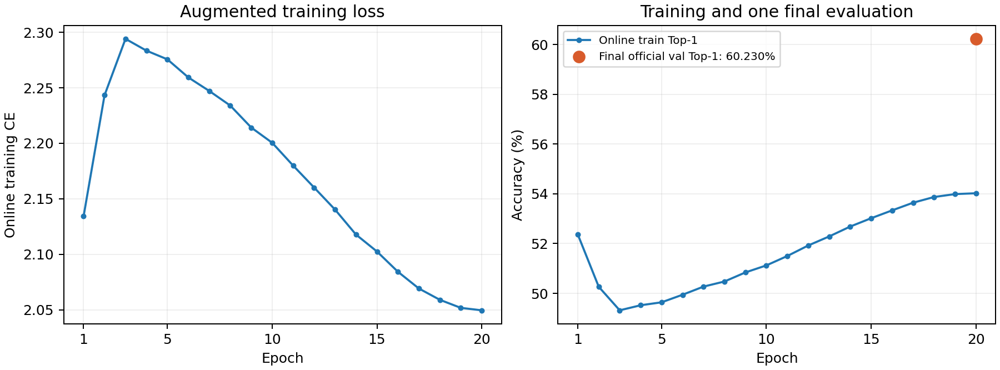

# 全量 ImageNet RGB160：固定20轮模型的最终验证

原始完整骨干 MCUNet-in2 在全部1,281,167张TRAIN上微调20轮后，固定第20轮模型，
在完整50,000张官方ImageNet验证集上取得 **Top-1 60.230%、Top-5 82.576%**，
CE **1.687063**。正确分类数分别为30,115和41,288。
验证完成后没有重新选轮、改变模型、调参或重新训练。

|项目|实际完成值|
|---|---|
|输入/结构|RGB160，原3×3 stride2首层，完整骨干，继承1000类头|
|训练数据|原始ImageNet TRAIN全部1,281,167张，1000类|
|训练预算|20轮，800,740更新，25,623,680图片呈现|
|补齐|每轮重复置乱后的前17张，保证全部BN batch32；共340次重复|
|选轮|预先固定第20轮；无开发集选轮、无早停|
|参数/计算量|729,392参数；67.2872M Conv/Linear MAC/图|
|格式|FP32，AMP/TF32关闭，验证BN为eval|
|官方val|完整50,000张，每类50张；单中心裁剪，无TTA|
|ImageNet-V2|未评估|

## 配方和数据边界

全部参数微调且BN更新，batch=BN batch=32，无梯度累积；seed2026。
RRC160（scale0.08–1、ratio0.75–4/3，bicubic+antialias）、水平翻转0.5、归一化2*x−1。
普通CE；SGD momentum0.9、WD4e-5（包含BN/bias）；全参数峰值LR0.001；
前2轮warmup包含在20轮cosine内，最后更新调度至零。
验证为解码RGB→短边182（bicubic+antialias）→中心裁剪160→2*x−1，batch32，末批16。

本次是后来单独确认的全量配方，包含旧20k开发成员，未保留历史TRAIN侧排除名单。
它不是队友冻结128k/20k实验的严格匹配对照，不能与旧20k开发准确率直接作泛化比较。
此前65.630%是128k训练的20k开发结果，不是本次官方val结果。
val有29个重复字节行；与完整TRAIN字节匹配799行。未按结果删除或重新划分任何图片；未作感知近重复审计。

验证使用用户提供的完整原始tar，全部50,000个预期成员和官方MD5
`29b22e2961454d5413ddabcf34fc5622`通过。读取全部50,000张原始JPEG，
没有用预缩放镜像替换；标签按公开valprep映射核验1000类、每类50张。
来源、检查点哈希及完整评估结果见`evidence/`。

## 指标与成本

训练曲线是随机增强、train模式下的在线累计；最终val是eval模式和中心裁剪，二者条件不同。
最后一轮训练Top-1 54.023%、CE 2.049536，
这些训练数值不冒充验证成绩。MAC只统计Conv/Linear推理，不含解码、预处理、反向传播；
本次没有MCU时延、能耗或INT8准确率结论。

## 复现和产物

- `results.csv`、`summary.json`：完整最终结果；`history.csv`：20轮记录。
- `class_results.csv`：1000类聚合准确率；`evidence/`：训练完成、输入检查和验证冻结证据。
- `code/training/`：原训练源码快照及实际使用的`manual_run.py`。
- `code/evaluation/evaluate.py`：完整val评估、每批原子保存、断点继续和独立指标重算。
- `code_manifest.json`：原始与公开源码哈希，以及仅为移除本机绝对路径所作的适配。

上游MCUNet固定 `9c164f8483003a5c6445871d94d30720aecc5918`，协议实现固定 `432bc72840dbe01820e4eefbcda710a16fb73f0d`。
环境沿用Python3.12.3、PyTorch2.7.1+cu128、torchvision0.22.1+cu128、Pillow11.2.1。
原始科学源码锁保留于`evidence/training_source_freeze.json`；路径适配后的公开副本哈希另列，
不能把公开适配哈希冒充原训练源码哈希，恢复旧checkpoint应使用原源码及契约。
训练后期实际使用manual入口，关闭资源阈值暂停；原控制器/看门狗源码只作为历史快照，
其原阈值描述不代表manual入口仍会暂停。

固定最终checkpoint SHA256：`0e848e571dc25ae09d5160ad756f037e21459b4b60add83e58a3f8f4a5b0a7a7`。
完整可恢复checkpoint、逐图预测、JPEG、标签清单与缓存均留在本地fyp，Git仅发布聚合结果、
代码、曲线和哈希。复现需自行准备合法取得的原始ImageNet数据和相应本地权重。
